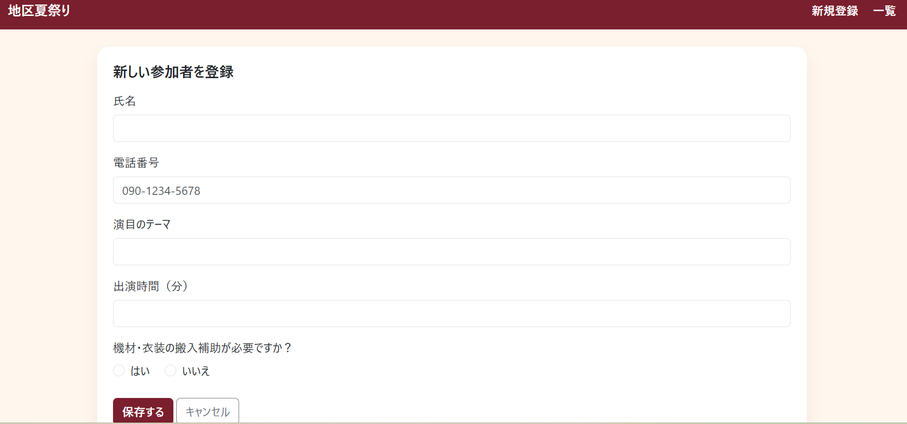

# Festival Entry Form（フェスティバル出演者エントリー）

**A web app for registering and managing festival performers, built with Spring Boot.**
フェスティバル出演者の申込・管理ができるWebアプリです（Spring Boot、専門学校の授業課題・個人制作）。




## Features / 主な機能

- Entry form for performers: name, phone, performance theme, duration, need for help with equipment / 出演者の申込フォーム
- Input validation with error messages (Bean Validation: required fields, length, phone format, 1–120 minutes) / 入力チェックとエラーメッセージ表示
- List, add, edit and delete entries (CRUD) / 一覧・登録・編集・削除
- Data stored with Spring Data JPA in an H2 database, with sample data on startup / Spring Data JPA + H2データベース
- Common layout and sidebar with Thymeleaf Layout Dialect, styled with Bootstrap 5 / 共通レイアウトとBootstrapによるデザイン

## Tech stack / 使用技術

Java 21, Spring Boot (Spring MVC, Spring Data JPA, Validation), Thymeleaf, H2 Database, Bootstrap 5, HTML/CSS/JavaScript, Gradle

## How to run / 起動方法

```bash
./gradlew bootRun        # Windows: gradlew.bat bootRun
```

Then open http://localhost:8080
H2 console: http://localhost:8080/h2-console (in-memory database, data resets on restart)

## Author / 作者

Anna Zorych — [LinkedIn](https://www.linkedin.com/in/anna-zorych/)
